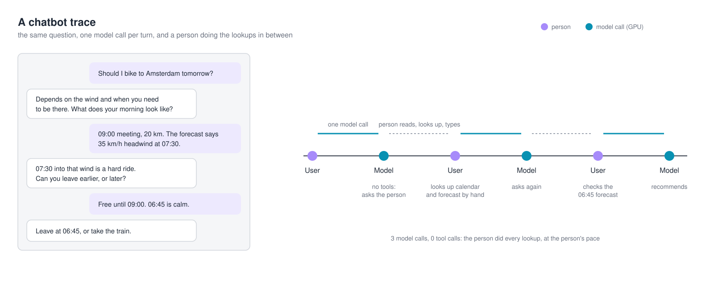
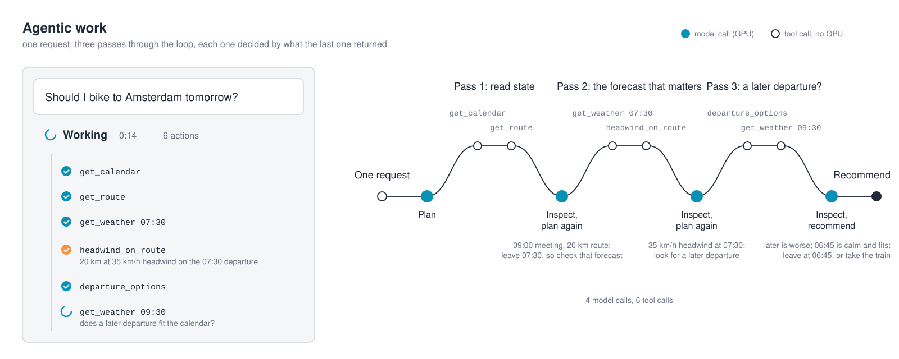
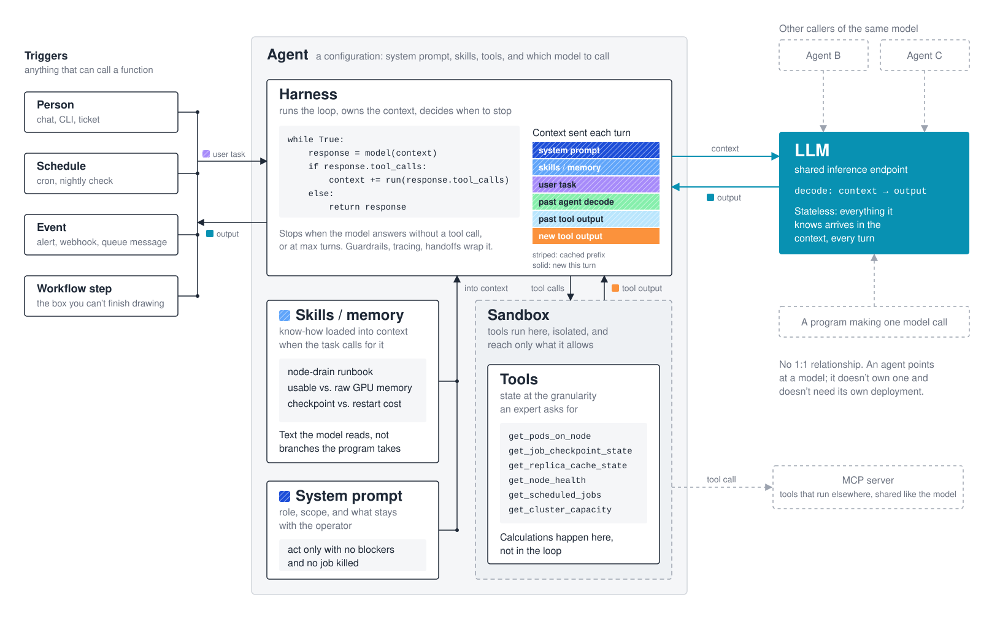
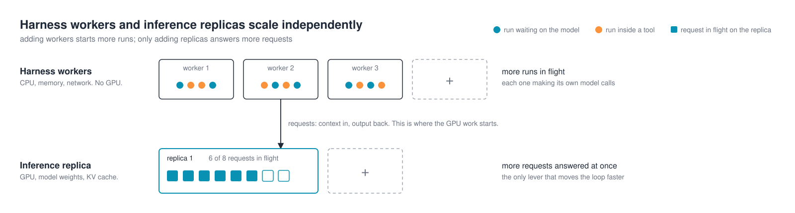
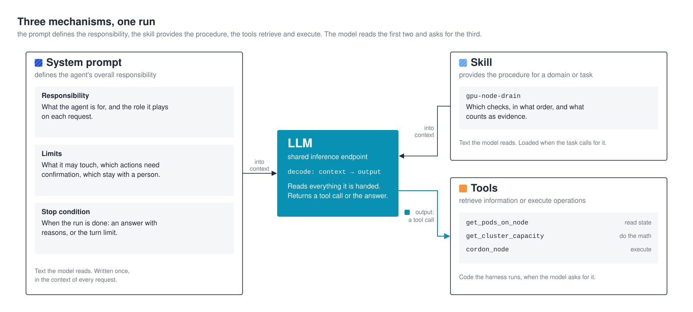

## Anatomy of an Agentic Workload

[The previous article](https://frankdenneman.ai/2026-10-13-agent-or-flowchart-find-the-box-you-cant-finish-drawing/) explored when an agent makes sense. It reduced an agent to a loop: a model, a set of tools, and a condition that tells it when to stop. The interesting part was the ability to decide what to do next based on the result of the previous step.

But what actually happens when that loop runs, and which parts of the infrastructure are involved?

This article establishes the terminology used throughout the series. It explains triggers, harnesses, tools, skills, execution environments, and the model itself. Understanding how these components interact provides the foundation for examining how agentic workloads differ from human chat, and what those differences mean for GPU compute, memory consumption, scheduling, and cache locality.

## From answering questions to executing tasks

A typical chatbot interaction starts when a person submits a prompt. The inference server processes the input tokens, generates output tokens, and completes the request. The person reads the answer and decides what to ask next. The conversation may remain open, but the model is not continuously executing on behalf of that conversation.

Consider the bicycle example from the previous article: "Should I bike to Amsterdam tomorrow?" The chatbot cannot check the calendar, route, or weather forecast without access to tools. Instead, it asks for more information. The person checks the relevant details, submits another message, and repeats the process until there is enough information to make a recommendation.



The diagram shows three model calls. Between those calls, the person checks the calendar, looks up the forecast, and provides the missing information manually. Each model request finishes before the next user message arrives. The pace of the conversation is determined by human interaction, not by the model.

Now consider the same question handled by an agent. Instead of asking the person to collect the missing information, the model can request actions through tools. The surrounding software executes those actions, collects the results, and sends them back to the model. The model uses that information to determine what to investigate next.



The agent starts by checking the calendar and route. A 09:00 meeting and a 20-kilometer journey establish the relevant departure time. The next step is to retrieve the weather forecast and evaluate the headwind along the route. When the result shows a 35 km/h headwind at 07:30, the agent investigates alternative departure times. A later departure turns out to be worse, while leaving at 06:45 provides better conditions and still fits the calendar.

The diagram shows four model calls and six tool calls, all initiated by a single user request. The model determines which information is needed, the tools retrieve or process that information, and the results influence the next step. The person no longer needs to perform the intermediate lookups. The important difference is not simply the number of model calls. The initial request starts a workflow that can continue without further human interaction. The next model request is triggered by the completion of a tool operation rather than by someone reading an answer and typing another question.

That distinction becomes interesting when looking at the infrastructure involved. Each model call requires inference, typically executed on GPUs. Checking the calendar, retrieving weather data, calculating the headwind along the route, and evaluating departure options are tool operations, generally executed using CPU resources or external services. An agent harness coordinates these activities and maintains the execution state (more about agent harnesses in the next section).

The GPU is not continuously busy throughout the agent run. Once a model call finishes, the agent harness may spend time executing tools or waiting for their results. During that interval, the inference server can process requests from other applications or agents. When the tool results arrive, the agent harness constructs another model request and execution continues.

There is another characteristic visible in the agent trace. Each subsequent model request needs enough context to continue the task. That can include the original question, instructions, previous model responses, and tool results. Some information is new, but much of the input may have already been processed during earlier model calls.

These execution patterns introduce three characteristics relevant to inference infrastructure. A single task can generate multiple model requests. Tool execution creates intervals between those requests, resulting in bursts of GPU demand rather than continuous execution. And repeated context creates opportunities to reuse previously computed inference state.

The following articles will examine the consequences for inference capacity, scheduling, and cache reuse. First, it is necessary to understand the components responsible for executing the agent workflow.

## Anatomy of an agent



Consider an AI infrastructure Kubernetes operation. An administrator wants to upgrade the GPU driver on a Kubernetes worker node and asks: **“Can I drain gpu-node-07 now?”**

This looks like a simple yes-or-no question, but the answer depends on several systems. The node may be running inference replicas with active requests and cached context. A training job might span multiple nodes connected through a high-speed network. Other nodes might have free GPUs, but not enough capacity within the required NVLink topology.

The agent needs to collect information before recommending an action. Available GPU memory alone does not establish whether the node can safely be drained. The next check depends on what the previous check revealed, exactly the kind of problem discussed in the previous article.

### The trigger

One thing many articles and presentations seem to omit is the question what actually triggers an agent? Something has to start the agent. That might be a person entering a command, a monitoring alert, a scheduled maintenance workflow, or another agent delegating part of its work.

A person can start the drain agent directly through a CLI command, a Slack integration, or a button in an operations portal. There is also a less direct path. Imagine an administrator talking to a general-purpose infrastructure assistant. The administrator asks whether gpu-node-07 can be drained. The assistant has several tools available, including a specialized drain agent. The model selects that capability and returns a tool call requesting its execution.

The assistant's agent harness receives the tool call and starts the drain agent. The model does not independently discover arbitrary agents running somewhere in the infrastructure. The available capabilities have to be registered or exposed through the surrounding software.

The same drain agent could be invoked by a Kubernetes controller or a scheduled maintenance workflow. In all cases, the agent receives a task. What differs is the system responsible for starting it. A scheduled maintenance workflow could start one hundred agents at 02:00 without a single administrator being logged in. The number of agent runs is no longer necessarily connected to the number of people using the platform.

### The agent and its harness

The agent describes the task and the capabilities available to perform it. Typically, an agent configuration contains a system prompt, a set of tools, optional skills, and a reference to the model it should use. But a configuration does not execute anything. That is the responsibility of the agent harness.

**The agent harness is the program that runs the agent loop.** It assembles the model request, sends it to the inference endpoint, receives the response, and executes any requested tools. Tool results are added to the context before the next model call. The process continues until the model produces a final answer, an execution limit is reached, or another stopping condition applies. The simplest harness can be expressed in a few lines of pseudocode:

```python
while True:
    response = model(context)

    if response.tool_calls:
        results = execute_tools(response.tool_calls)
        context.extend(results)
    else:
        return response
```

A production agent harness also handles errors, tool-call arguments, context management, execution limits, permissions, and other operational concerns. But the underlying mechanism remains recognizable.

Several frameworks and applications provide this functionality. LangGraph offers a graph-based runtime for stateful agent execution. LangChain provides agent abstractions built on LangGraph. The OpenAI Agents SDK and Claude Agent SDK provide their own agent loops, tool integration, and execution controls.

[OpenClaw](https://openclaw.ai/) and [Hermes](https://hermes-agent.nousresearch.com/) are also examples of agent harnesses, although they are packaged more as complete agent environments than as libraries for building workflows. They combine the agent loop with capabilities such as persistent sessions, tool execution, and integrations with communication channels. They can run as long-lived services, allowing agents to respond to messages and events without requiring a developer to start a new process for each task.

Organizations can use these frameworks, extend them, or build their own harness. A Python application that maintains context, calls a model, executes tools, and evaluates stopping conditions already implements the essential behavior.

From an infrastructure perspective, the harness is application software. It runs on a conventional operating system, manages state, makes API calls, and waits for responses. It does not execute the model's transformer computations itself. A developer tool might run the harness on a laptop. An enterprise service might run it inside a Kubernetes deployment. A larger platform might operate many harness workers concurrently.

The harness consumes CPU, memory, and network resources. Depending on the implementation, it may also require persistent storage for execution state and logs. It does not require a GPU simply to orchestrate the agent. The GPU-intensive work happens when the harness sends a request to the model.

This separation matters operationally. Agent harness workers can scale independently of inference replicas. Adding agent harness capacity allows more agent runs to execute, but it does not automatically increase the inference capacity available to them.



### The tools

The model cannot inspect the state of a Kubernetes cluster by itself. It needs a way to retrieve that information. That is where tools come in. A tool is a function or service that performs a defined operation and returns a result. For the drain agent, examples include `get_node_workloads(node)`, `get_training_job_topology(job)`, `get_available_gpu_capacity(cluster)`, `get_inference_replica_state(node)`, and `get_node_health(node)`. The model decides which tool to call. The harness executes it and returns the result.

There is another reason to use tools beyond accessing external systems. **LLMs are reasoning engines, not calculators.**

Suppose the task is to determine whether a host is overloaded. One approach would be to retrieve thousands of CPU utilization samples, send the entire array to the model, and ask it to calculate the average and the 95th percentile. But why do that? A small Python function can perform those calculations quickly and deterministically. Instead of sending thousands of samples, the tool returns the relevant metrics:

```json
{
  "host": "gpu-node-07",
  "cpu_average_15m": 74.2,
  "cpu_p95_15m": 93.1,
  "threshold_exceeded": true
}
```

The model uses that information to decide whether CPU pressure matters to the investigation and what it should check next. Python performed the calculation. The model reasons about the result.

Tools can be implemented in two places. The simplest is a function in the agent harness's own code, as in the examples above. The other is a Model Context Protocol (MCP) server: a separate process or service that exposes tools over a standard interface, so that one tool implementation can serve any harness that speaks the protocol. A local MCP server runs as a child process of the agent harness. A remote one is an HTTP service, which makes it a workload in its own right: something to deploy, secure, and version, and something many agents can share, the same way they share the model endpoint. A single Kubernetes MCP server could serve the drain agent, a capacity-report agent, and an administrator's general assistant at once.

Two things follow for infrastructure. When a tool runs on an MCP server, that server's credentials and network reach define what the tool can do; the boundary has moved from the harness's sandbox to the server. And every tool, local or MCP, contributes its definition to the model's context on every request: name, description, and argument schema. Connect ten MCP servers with a dozen tools each and the model reads all of those definitions before it reads the task. The measurement in the article [Anatomy of an Agent Request](http://localhost:1313/2026-10-22-anatomy-of-an-agent-request/)  shows what that costs.

This mirrors an observation from an [ITQ](https://itq.eu/nl/) hackathon. Several teams were building applications that used sensor data. Initially, they sent raw sensor readings directly to an LLM and asked it to interpret the measurements. The results were inconsistent. LLMs are reasoning engines, not calculators. The teams eventually introduced a small machine learning model to process the sensor stream. Instead of asking the LLM to work through the raw measurements, they exposed the ML model through a tool and passed its output to the LLM.

That changed the division of responsibility. The specialized ML model processed the sensor data. The LLM interpreted the outcome and decided what to do next. A Python calculation can provide a deterministic result, while a trained ML model produces a prediction or classification that may still have uncertainty. But the architectural principle is the same: **use specialized software to process data, and use the LLM to decide how the resulting information affects the task.**

This also reduces the amount of context sent to the model. Instead of thousands of raw measurements, the model receives a compact result. Tool execution introduces another important behavior: while a tool runs, the harness may be waiting for an API response, a command, or another service. During that period, the agent does not necessarily have an active inference request. The GPU can serve other requests while the harness waits.

### The system prompt

The system prompt defines the agent's role, scope, and intended behavior. For the drain agent, it might look like this:

```text
You plan node drains for GPU clusters.

The user names a node. Determine whether it can be
 drained now. If it cannot, explain why and list
 the available options.

Retrieve workload, capacity, topology, and health
information through the available tools.

Do not estimate infrastructure state.

When a workload spans multiple nodes, inspect the
relevant nodes before making a recommendation.

Recommend an action, but leave the decision to the user.

Do not terminate workloads or perform disruptive
actions without explicit authorization.

Stop when you can provide a supported go/no-go
recommendation, or after 20 tool calls.
```

Notice what the prompt does not contain. It does not describe every possible Kubernetes scheduling constraint, every GPU topology, or every procedure for relocating a training job. Those details belong in tools and domain-specific knowledge available to the agent. The prompt tells the agent what it is responsible for and how it should behave. It does not need to become an operations manual.

There is also an important security distinction. A prompt can instruct the model not to terminate production workloads, but that instruction is not a security control. If an agent must not terminate workloads, the execution environment should enforce that restriction through permissions, credentials, approval gates, and tool access. The prompt communicates the intended behavior. The infrastructure determines which actions are actually possible.

### Skills

A skill provides additional knowledge or procedures that the agent can use for a particular task. The system prompt defines the agent's responsibility, while a skill explains how to handle a specific situation within that responsibility.

For example, the drain agent might have access to a skill called `gpu-node-drain`:

```markdown
---
name: gpu-node-drain
description: Use when asked whether a GPU node can be drained, cordoned, or taken out of service for maintenance. Covers training jobs, inference replicas, and scheduled work on the node.
---

# GPU node drain

Work through every section that applies. A section applies when the
tool results show the node hosts that kind of work. Verdicts come from
tool results, never from estimates.

## 1. What is on the node

Call `get_pods_on_node(node)` and `get_node_health(node)`.
Classify each pod as training, inference, or other. If the node is
already unhealthy, say so: a failing node changes the cost of waiting.

## 2. Training jobs

For each distributed training job on the node:

1. Identify every node the job spans. `get_job_checkpoint_state(job)`
   returns the member list with the checkpoint state.
2. Check whether the job checkpoints, when it last did, and when the
   next checkpoint is due.
3. Check replacement capacity for the whole job, not for this node's
   share: `get_cluster_capacity(gpu_type, count, topology)`.
4. Confirm the replacement GPUs sit in one NVLink domain and on the
   fabric the job requires.

Free GPU count is not evidence that a job can be rescheduled. Eight
free GPUs spread over four nodes do not replace one node of eight.

A job that cannot checkpoint, or has no replacement capacity, is a
blocker. A job whose next checkpoint lands inside the maintenance
window is preparation: wait for it.

## 3. Inference replicas

For each replica on the node:

1. Get in-flight requests and cached context:
   `get_replica_cache_state(replica)`.
2. Check whether the router can stop sending new work to it.
3. Determine whether the in-flight requests can finish on their own.
4. Check replacement capacity for the replica: `get_cluster_capacity`.

Cached context is lost when the replica stops. Traffic that depends on
it pays full prefill elsewhere. Report that as a cost, not a blocker.

## 4. Scheduled work

Call `get_scheduled_jobs(node, window)`. A reservation or queued job
that lands on this node during the window is preparation: move it, or
shrink the window.

## Verdict

Return exactly one of:

- Safe to drain
- Drain possible after preparation
- Drain blocked

List the reasons. For preparation, list each step and who performs it.
```

The skill does not execute these steps itself. It provides instructions that the model can use to determine which tools to call and how to interpret the results. A skill can also include reference material, scripts, or other resources, depending on the agent harness implementation. Some agent harnesses load the full skill only when needed, while keeping a smaller description available so the model can decide when to use it.



The distinction is useful. The system prompt defines the agent's overall responsibility. The skill provides procedures for a particular domain or task. Tools retrieve information or execute operations. These are three different mechanisms, even though they work together during the same agent run.

### The sandbox

Tools sometimes need to execute commands, read files, or access infrastructure APIs. Those operations need an execution environment. For a developer running an agent locally, that might be the developer's own shell, without a separate isolation boundary. For an enterprise deployment, it could be a container, pod, microVM, or VM with restricted access to the surrounding environment. This is commonly referred to as the sandbox.

The sandbox defines what tool execution can reach. For the drain agent, that might be read access to the Kubernetes API, the job controller, and the inference router, and nothing else. It should not inherit the harness host's permissions, and it should not reach every cluster or production system by default. Network policies, service accounts, filesystem restrictions, and short-lived credentials help enforce that scope.

The reason this matters more for an agent than for a conventional service is the agent loop itself. The model can request tool operations, and tool results flow back into the context the model reads next. A file, a ticket, or a web page retrieved by a tool can contain malicious instructions. This is known as prompt injection. The model may interpret those instructions as something it should follow, even though they came from an untrusted source. The prompt describes what the model should do, but permissions and execution boundaries determine what the tools can actually do.

Credentials are a clear example. The tools need to authenticate to the Kubernetes API, the job controller, and the router, using API keys or service accounts. These credentials should be managed separately from the model's context and made available only to the components that need them. Depending on the implementation, tools might receive credentials through mounted secrets, short-lived tokens, or a credential broker that authenticates requests on their behalf.

There is an important distinction here. A mounted secret or environment variable keeps a credential out of the model's prompt, but code executing inside that sandbox may still be able to read it. A credential broker provides a stronger separation by allowing tools to make authenticated requests without receiving the underlying credential. NVIDIA discusses these approaches in its [guidance on sandboxing agentic workflows](https://developer.nvidia.com/blog/?p=112277).

The model does not need to see the credentials. It produces a tool call such as `get_pods_on_node("gpu-node-07")`. The harness and tool execution infrastructure handle authentication. Keeping authentication outside the model context avoids unnecessarily including credentials in inference requests. Tool implementations must also prevent secrets from appearing in returned results or logs.

Credentials can also be scoped to individual agent runs. A drain agent evaluating one Kubernetes cluster does not need credentials for every cluster in the environment. Short-lived, read-only credentials can limit both the operations available to the agent and the duration of that access. Destroying the sandbox should terminate its access, with credentials expired or revoked independently where necessary.

Lifecycle and scale are the operational half. One deployment pattern is to create an ephemeral execution environment for each agent run, provision it with the required permissions, and destroy it when the run finishes. The context belongs to the harness; the working directory belongs to the sandbox. This also creates a scaling consideration. If two hundred agent runs start at 02:00, a per-run sandbox design requires two hundred execution environments.

Startup time becomes part of tool latency. Creating a pod or microVM takes time, and that delay occurs before the requested tool can execute. Warm pools of execution environments can reduce this overhead, but they consume resources even when no tools are running. The platform has to balance isolation, startup latency, and resource utilization.

One more boundary is easy to miss. Tool results become part of the context, and that context may be sent to the model on subsequent calls. If the model is hosted outside the environment, sensitive data returned by tools may leave the infrastructure. Restricting the sandbox's access reduces exposure, but the tool's output is another control point. Tools should return only the information required for the task rather than entire objects containing unrelated data.

Not every tool executes inside the harness's environment. Some run on remote MCP servers, as described earlier. In that case, the MCP server has its own execution boundary, credentials, and network permissions. The important question is where an operation actually executes and which permissions apply at that point.

Infrastructure consequence: sandboxes are workloads that need placement, resource allocation, isolation, and lifecycle management. In a per-run design, their number scales with active agent runs. Their startup time contributes to tool latency, and their permissions determine which infrastructure operations an agent can perform. None of them require a GPU unless the tool itself executes GPU workloads.

### The LLM

Please, look again at the agent anatomy diagram. The model is deliberately drawn outside the agent.

An agent does not need its own model deployment. The agent harness sends requests to an inference endpoint. That endpoint might consist of a single model server or several replicas behind a router. Other agents, applications, and ordinary programs can use the same endpoint.

The inference service does not need to know that a request belongs to a drain agent. It receives input tokens and generates output tokens, potentially including a request to call a tool. The agent harness interprets that output and decides how execution continues.

The model also does not own the agent's conversation history. The agent harness maintains the execution context and supplies the information required for each model call. The inference runtime may retain previously computed state, such as KV cache entries, but that is different from maintaining the agent's workflow.

The system has two distinct parts: the agent harness manages agent execution, while the inference platform processes model requests. Both can scale independently, but they are connected through the requests generated by the agent loop.

## Closing

An agent is not a model with a different name. It is a software system that coordinates model calls, tools, and execution state to complete a task.

The trigger starts the run. The agent harness manages the loop. The system prompt defines the agent's responsibility. Skills provide domain-specific procedures. Tools retrieve information and execute operations. The sandbox provides an execution environment with controlled access to the surrounding infrastructure. The model sits outside this environment, exposed through an inference endpoint that multiple agents and applications can share.

This separation matters for infrastructure design. Agent harnesses, tool services, sandboxes, and inference endpoints have different resource requirements and scale independently. Increasing the number of active agents does not automatically translate into an equivalent increase in GPU utilization.

But understanding the components is only half the story. What happens when the harness assembles a request and sends it to the model? How much information does that request contain, how often does the agent call the model, and what happens between those calls?

The next article, *Anatomy of an Agent Request*, examines what actually arrives at the inference endpoint and how agent execution translates into GPU demand.

