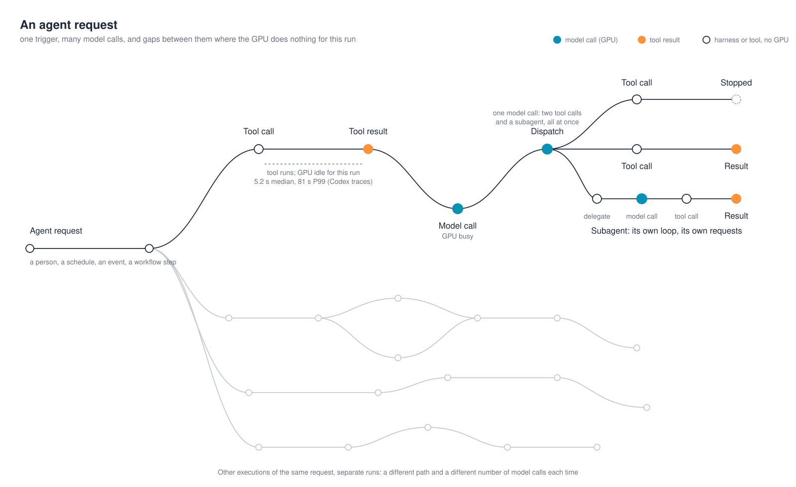

## Anatomy of an agent request

The [previous article](https://frankdenneman.ai/2026-10-20-anatomy-of-an-agentic-workload/) took the agent apart, using the drain agent to name the parts. This half takes apart what those parts produce: the requests that arrive at the inference endpoint. For that we need measured runs, so the example changes to the agentic workloads that have public published traces, which are coding agents. Seen from the inference endpoint, each component answers one question about the requests. The trigger decides how many runs start and when. The harness decides how many requests a run makes. The tools decide when the next one can be sent. The system prompt, the tool definitions, and the skill decide what every request begins with. The sandbox adds time, not tokens. The model receives the sum. The subsections below take them in that order.

The numbers come from two analyses by the vLLM team. The first is [vLLM x AgentX](https://vllm-project.github.io/2026/09/08/vllm-agentx.html), a serving study of the AgentX benchmark. The second is [vLLM x Mooncake](https://vllm.ai/blog/2026-05-06-mooncake-store), which analyzed 610 sessions of OpenAI's Codex coding agent working through [SWE-bench Pro](https://labs.scale.com/leaderboard/swe_bench_pro), a benchmark of real software-engineering tasks, and published per-turn medians for one representative session: how large each request was, where its tokens came from, and how long the agent waited between requests. That session is detailed enough to take one request apart.

### The trigger decides how many runs start, and when

Look at where the trigger's contribution sits in the figure. It supplies the task, a few dozen tokens, and the task is fourth in the request, behind the system prompt, the tool definitions, and the skill. The thing that started the run is not the thing the model reads first.

Two reasons, and both are the harness's doing. The model reads a request front to back, so the harness puts the instructions and the available tools before the thing they apply to, the way a function's signature comes before its arguments. And the harness puts everything that never changes first, deliberately. An inference server can reuse the work it did on a request's opening tokens only up to the first token that differs from what it processed before, so a fixed prefix followed by the variable task keeps that reusable stretch as long as possible. What the server does with it is the next article.

What the trigger does decide is when runs start and how many start together. Neither dataset has a person at a keyboard. The 610 Codex sessions were started by the benchmark runner, one per task, in batches; the AgentX sessions the same way. That is the software-triggered case from the trigger section in its purest form: the runner decides how many runs start and how close together, and the inference endpoint sees every run's first request arrive within seconds of the others. A person starting one session from a terminal produces one run at a time; a runner, a scheduler, or an alert produces as many as it is told to.

### The harness decides how many requests each run makes

Each pass through the loop is one request. [The AgentX analysis](https://vllm-project.github.io/2026/09/08/vllm-agentx.html) reported a median of 43 model turns per session; [the Codex analysis](https://vllm.ai/blog/2026-05-06-mooncake-store) a median of 33. One task is no longer one request followed by a human pause. It is a sequence of dozens.

A run can also fan out, and there are two ways to do it that look alike and are not. The first is parallel tool calls: the model returns several tool calls in one output, the harness runs them at the same time, and all the results land in the same context. That is one model request and a longer gap. The second is a subagent: a tool call that tells the harness to start another loop, with its own context, its own model calls, and its own result handed back to the parent when it finishes. That is more requests, and they overlap with the parent's. In the AgentX data, 44% of sessions started at least one subagent, with a median of four in those sessions.

Other runs of the same task take other paths. Some finish after a few model calls; some need dozens; some fan out. How many requests a run will make is decided during the run.

### Tool latency is an inference capacity question

The model endpoint spends GPU compute and GPU memory on a request only while it is processing it: from the moment the agent harness sends the context to the moment the last output token comes back. A session that is waiting for a tool result costs the GPU nothing, except the memory it may still hold for that session's prefix in its KV cache.

This is a good moment to compare CPU and GPU behavior, because the habits from one do not carry to the other. On a CPU, a worker thread in a conventional request-serving application that is blocked on I/O still occupies its slot in the thread pool, with its stack and its open connection, until the read returns. The core is free, but the slot is not, and the slots are the server's capacity: fill the pool with threads waiting on slow I/O and the application stops accepting requests while its cores sit idle. On the GPU, a session waiting on a tool occupies no slot at all: the request is finished. The model endpoint returns the tool call, frees the request's slot, and processes other sessions' requests until the next one arrives. A hundred sessions waiting on slow tools leave the GPU free for a hundred others. GPU capacity is spent only on the requests being processed at that moment and the KV-cache memory they need.

A session's next request arrives when its tool returns. The time between two requests is tool latency, so for a given number of sessions, the tools decide how many requests are on the GPU at once. Faster tools make shorter sessions that keep more requests on the GPU; slower tools make longer sessions that keep fewer there.

The OpenAI Codex analysis measured both halves of that cycle across its 610 sessions: a request takes roughly 3 to 10 seconds to process after the first, and the wait for the tool result that follows has a median of 5.2 seconds and a 99th percentile of 81.4 seconds. With a 5-second request followed by a 5.2-second wait, a session has a request on the GPU about half of its running time. The long waits lower that fraction: once the tail is included, about a third.

Three consequences follow for the platform.

The first is capacity. The number of requests on the GPU at once is the number of sessions times the request time, divided by the request time plus the tool latency. One hundred of these sessions keep thirty to fifty requests on the GPU at any moment, so a model endpoint sized for one hundred concurrent requests, which is what counting sessions suggests, is two to three times larger than the load it will see. Halve the tool latency and the same hundred sessions add a third to that load; double it and they remove a third. Only when the wait is far longer than the request does halving it come close to doubling the load.

The second is the shape of that load. The waits are not synchronized, so the count is never steady: it rises when several tool results arrive within the same second and falls when a few sessions are sitting in an 80-second wait. The model endpoint has to be sized for the peaks of that count, not its average, and the peaks arrive without warning.

The third is the KV cache. The model endpoint keeps a session's prefix in GPU memory until it needs that memory for other requests. A 5-second wait is short enough that the prefix is usually still there when the next request arrives; an 80-second wait, under load, is long enough that it has usually been evicted, and that session's next request pays to recompute all of it, which is the expensive part of every request. The tail of the wait distribution is therefore also the tail of the request-cost distribution: the sessions that come back latest come back most expensive.

### The platform underneath the tools sets the GPU's efficiency

Sandbox startup, storage latency, and CPU headroom are GPU efficiency levers. That sounds backwards, so here is the chain.

Tool latency is both the amount of inference demand and the cost per unit of it. The demand half is the arithmetic above. The cost half is the KV cache: a session whose next request arrives while its prefix is still in GPU memory pays only for the new tokens, and a session whose next request arrives after the prefix was evicted pays to recompute the whole thing, 11.5K tokens in the Codex session and over 20K in the Claude Code measurement, before it produces a single token of output. Every request that misses the cache costs the GPU several times the compute of one that hits, so the hit rate decides how many requests a GPU can process per second, and the wait decides the hit rate.

Three parts of the platform set the wait. How fast a sandbox starts: a container or microVM that takes seconds to come up adds those seconds to the first wait of every session, and to every wait if sandboxes are created per tool call. How fast the tools' data arrives: a tool that reads logs, metrics, or files from storage with poor read latency, or over a congested network, waits for every byte before it can return. How fast the tools compute: a harness host or sandbox with CPU to spare finishes the calculation and returns; one that is oversubscribed queues it. Shorten any of the three and the next request arrives sooner, the prefix is more likely to still be in the cache, the request costs less GPU compute, and the same GPUs complete more requests per second. Lengthen any of them and the reverse happens on every session at once.

None of those three is a GPU, and none of them appears in a sizing exercise that counts sessions. Sandbox startup time, storage read latency, and CPU headroom on the tool side are usually treated as the agent application's concern, or nobody's. They are the inference platform's concern. They decide how much of the GPU's time is spent re-reading what it already read, and that is the largest lever on inference cost and throughput that sits outside the GPU itself.

## Closing

An agentic workload cannot be characterized by the number of agents running or the number of people interacting with them. The behavior of the agent harness, the tools it executes, and the context it sends to the model determine the actual inference workload.

The measurements from AgentX and Codex illustrate why this distinction matters. A single agent run can generate dozens of model requests. Those requests are separated by tool execution, can overlap when work is delegated to subagents, and often carry substantially more input tokens than output tokens.

From an infrastructure perspective, three quantities need to be distinguished: the number of active agent runs, the rate at which those agents submit inference requests, and the number of requests being processed simultaneously. They are related, but they are not interchangeable.

Even these measurements do not tell the entire story. Two requests with the same input length can have very different computational costs. An inference server may have already processed most of the input during an earlier request, or it may need to process everything again.

That distinction becomes particularly important for agentic workloads because the harness repeatedly sends much of the same context back to the model.

The next article, *The Agent Sends Everything, Every Time*, examines why that repeated context creates opportunities for prefix caching, how previously computed KV cache can be reused, and why routing decisions influence the amount of work the GPU needs to perform.
