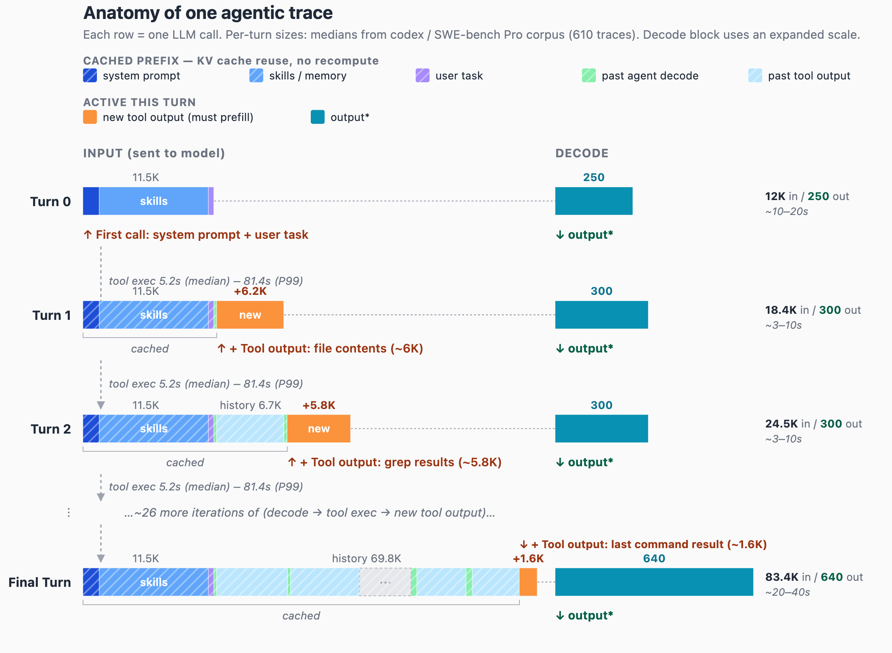

## The model remembers nothing, the server might

The [previous article](https://frankdenneman.ai/2026-10-22-anatomy-of-an-agent-request/) examined how an agent builds an inference request and how its context grows as the task progresses. But why does the agent need to send so much information with every request? The answer starts with a fundamental characteristic of how language models operate: the model itself does not remember previous requests.

Every inference request is a new execution, and the model can only reason about information included in its current input.

During inference, input tokens pass through the model's layers, producing intermediate values called activations. These activations are temporary, and their memory can be reused once they are no longer needed. The model's weights remain unchanged, so after the request completes, the model itself returns to the same baseline it had before the request.

For an agent, the full context provides continuity. The system instructions define how the model should behave. Tool definitions describe which actions are available. The conversation history contains the original task, decisions already made, actions taken, and results returned by tools. Without that information, the model could repeat work, contradict earlier decisions, or lose track of the task it is trying to complete.

The agent harness maintains this context and sends it with each new inference request. The inference engine may still hold the KV cache from an earlier request, allowing it to reuse previously computed attention states. However, that cache is managed by the inference engine, not the model or agent harness, and may be evicted when memory is needed.

This explains why the final request in the Codex session from the previous article contains 83.4K input tokens, even though only 1.6K tokens represent new information. The agent harness sends the accumulated context to preserve continuity, while the inference engine determines how much of the previous computation it can reuse.

This repeated context has significant consequences for inference infrastructure. Processing the same tokens again consumes GPU compute, increases request latency, and reduces the capacity available for other workloads. Reusing previously computed KV cache entries can avoid much of that work, but only if the cache is still available when the next request arrives.

This article examines what happens to those repeated tokens, the computational cost of processing them again, how prefix caching reduces that cost, and why the time between agent requests matters for cache retention and overall GPU efficiency.

## The agentic payload

The figure comes from the vLLM team's analysis of 610 Codex sessions on SWE-bench Pro, the same [vLLM x Mooncake](https://vllm.ai/blog/2026-05-06-mooncake-store) study the previous article drew its per-turn medians from. Read it row by row and the pattern is plain. Every request starts with the same 11.5K tokens: system prompt, tool definitions, skills. Then comes everything the session has produced so far. Only the orange segment at the end is new: 6.2K of file contents on turn 1, 5.8K of grep results on turn 2, 1.6K of command output on the final turn.

Add up the whole session. Thirty requests grow from 12K to 83.4K tokens, so the harness sends roughly 1.4M input tokens over the run. The new information in all of them together is about 84K tokens, the size of the final context. About 94% of every token the endpoint receives is a token it has received before.

| Segment | Tokens per request | Sent over 30 requests |
| --- | --- | --- |
| Static prefix (system prompt, tools, skills) | 11.5K | ~345K |
| Session history (task, past decodes, past tool output) | 0 → 70K | ~1.0M |
| New tool output | 1.6K–6.2K | ~72K |
| Output (decode) | 250–640 | ~9K |

The middle column is one request; the last is the sum over all thirty, because every segment is resent each time. The history grows from 0 to 70K, so it averages about 35K per request and adds up to about 1.0M.

The output column explains why agents are called input-heavy: about 150 input tokens per output token. The first two columns explain why that ratio is misleading. Almost none of that input is new; the question is whether the GPU processes it as if it were.

*Totals assume the context grows evenly between the published turns and use the per-turn medians from the vLLM x Mooncake analysis. The output row uses the median decode length, so the 30-request sum is a lower bound. All totals are approximations, not measurements.*

## What a cache hit saves the session

A cache hit turns an 83.4K-token prefill into a 1.6K-token prefill. Prefill is the compute-bound phase that computes and stores the keys and values, the KV cache, for every input token before the first output token can be produced. If the KV cache from the previous turn is still in GPU memory, the engine computes only the new tokens and attends them to the cached ones.

Over the session that is the difference between about 84K prefilled tokens if every turn hits and about 1.4M if every turn misses, roughly 17x. For a dense 70B-parameter model the weight matrices alone cost about 140 GFLOP per token (two FLOPs per parameter), which puts the session at about 12 PFLOP with hits versus about 200 PFLOP with misses.

That 140 GFLOP figure is a lower bound. It counts the linear layers and ignores attention, whose cost per token grows with the number of tokens already in the context. At 80K tokens, attention adds roughly 200 GFLOP per prefilled token for a model of this size, which is more than the weights themselves. A miss at turn 30 therefore costs closer to 2x the weights-only estimate, while a hit prefills 1.6K tokens and pays the attention cost only for those. The real gap between hits and misses is larger than 17x, not smaller. The weights-only number is used in the rest of the article because it is simple to compute and already makes the point.

The saved FLOPs are not just saved for this session. They are compute the GPU has available for other sessions.

The memory saving is smaller than the token count suggests. The new tokens still attend to every cached key and value, so the GPU reads the whole 83.4K-token KV cache from memory to produce the next token. A hit removes the computation for old tokens, not their memory footprint. The context has to be resident either way.

A hit also lowers time to first token and end-to-end latency for this turn. Each model call that misses adds its full prefill time to the agent loop.

## What a cache hit saves everyone else

A cache hit does not only make one session cheaper; it returns GPU time to every request sharing that GPU. Three effects add up.

**The static prefix is shared.** The first 11.5K tokens are identical for every session of the same agent. An inference server such as vLLM stores the KV cache in fixed-size blocks and identifies each block by a hash of its tokens and of every token before it. Two sessions with the same opening tokens map to the same blocks, so one copy in GPU memory serves a hundred sessions. This is also why the harness puts the unchanging parts first: a block is reusable only if everything in front of it matches, so one changed token early in the request, a timestamp in the system prompt for example, makes everything after it unique.

**Prefill competes with decode.** Most model deployments batch prefill and decode work together, and a long prefill takes its share of each step's compute budget for many steps in a row. A session that misses and recomputes 80K tokens slows the token generation of every other request on that GPU while it does. A cache hit avoids that slowdown entirely.

**Cached blocks hold no memory back from running requests.** A cached block that no running request uses is not reserved. It sits in the free block queue, available for reuse if its prefix comes back, overwritten if the server needs the space. Caching is opportunistic: it fills memory that would otherwise be empty, and gives it up the moment active requests need it. That is the mechanism the next section is about, because it decides how long a session's history survives.

## The cache is a conveyor belt

At startup vLLM reserves a fixed share of GPU memory, set by gpu_memory_utilization, subtracts the model weights and the peak activation memory it measures during a profiling run, and hands the remainder to the KV cache. That memory is split into fixed-size blocks, the block pool, and the pool does not change size after startup. Every block is in one of two states. It is in use by a running request, in prefill or decode, and cannot be evicted. Or it is free, sitting in the free block queue with its contents intact and still usable until the engine overwrites it for another request.

A useful analogy for that queue is a conveyor belt with a drop at the end. When the request ends and the agent goes back to waiting on a tool, its blocks change from in use to free and go on the belt. vLLM evicts with a least-recently-used (LRU) policy: whenever the inference engine needs a block for any request, it takes the free block that has gone unused longest, the one at the drop, and overwrites it. Every other free block moves one step closer to the edge. If the session's next request arrives while its blocks are still on the belt, the inference engine finds them, marks them in use again, and skips computing them. The [vLLM prefix caching design](https://docs.vllm.ai/en/latest/design/prefix_caching/) describes the free block queue and its LRU eviction in detail.

<iframe src="/animations/kv-cache-conveyor-final.html?embed" title="The KV cache is a conveyor belt" loading="lazy" style="width:100%;height:760px;border:0"></iframe>

The animation follows one session through three tool cycles. Each request adds a block: last turn's new tool output, orange, turns blue as the GPU pulls it back in, because it is now part of the prefix. Try the three tool waits. At the 5.2-second median, the prefix is still on the belt every time and the GPU prefills only the new tool output. At 20 seconds on a busy GPU, the newest blocks fall off first and the GPU recomputes them. At the 81-second P99, the whole prefix is gone, and the GPU spends visible time computing it again before it can start on the new work.

The belt explains which parts of the trace survive a tool wait:

- **The prefix grows every turn, and so does what is at risk.** After thirty turns the session has 80K tokens on the belt, all of them already prefilled once.
- **Eviction takes the tail first.** vLLM returns a finished request's blocks in reverse order, so the newest blocks of a sequence reach the drop before its oldest. The reason, per the [vLLM design](https://docs.vllm.ai/en/latest/design/prefix_caching/): a request's last block hashes the most tokens, so it is the least likely to be reused by another request, and should be evicted first. A partially evicted session keeps the start of its prefix and recomputes its most recent turns, rather than losing everything.
- **The shared part of the prefix rarely reaches the drop.** The system prompt, tool definitions and skills are identical across all sessions of the same agent, such as the 610 Codex sessions in the trace data. Other sessions of that agent on the same replica keep pulling those blocks back in. A different agent shares none of them: its system prompt differs, so its very first block already hashes differently. The animation leaves this out for clarity; a session's own history only gets pulled back by that session.

The belt's speed is not set by the session. It is set by everything else on the GPU: other agent sessions, chat traffic, a batch job, a RAG request with a large document. The time a block survives is roughly the free cache capacity divided by the rate at which new tokens arrive. An illustrative case: 500K tokens of free cache (about 160 GB of KV cache at roughly 320 KB per token, for a 70B-class model with grouped-query attention at BF16, spread across a node) and 100 sessions like the Codex one, each adding about 3K tokens every 10 seconds. That is about 30K tokens per second, and a belt about 17 seconds long. A 5.2-second tool wait comes back well before the drop; an 81-second wait comes back to an empty belt.

Cache misses speed up the belt. A hit allocates blocks only for its 1.6K new tokens. A miss allocates blocks for everything that fell off. The 11.5K static prefix almost always survives, because other sessions of the same agent keep pulling it back, so a session that lost its history recomputes and reallocates about 72K tokens. In the example above that is about a seventh of the belt in one request. Every other session's prefix moves toward the drop by that amount, some of them fall off, their next requests miss and allocate their own 72K, and the belt accelerates again. The recompute also lengthens each miss's turn, which holds the session's own blocks in use longer and shrinks the free pool for everyone. Under load, misses cause misses.

Two assumptions sit under this model and both matter in production. The first is that a block that reaches the drop is lost. It does not have to be. Instead of letting the computed keys and values go to waste, KV cache offloading moves evicted blocks to the host's CPU memory or to local NVMe devices, and an inference engine can pull them back when the prefix returns. The drop then becomes a copy to slower memory rather than a recompute, and the P99 case changes from a full prefill into a transfer whose cost depends on bandwidth and block size. The belt model in this article still describes the GPU tier exactly, and that tier is where the hit is cheapest, but offloading changes what a miss costs. A later article in this series covers how offloading works and when it pays off.

The second assumption is a single inference engine. Most deployments run several replicas behind a router, and each replica has its own block pool. The session's blocks are on one belt. If the router sends the next request to a different replica, the request misses regardless of how long the tool took, and the only shared content is whatever that replica happened to cache from other sessions. Nothing in this article works unless the router sends each request to the replica that holds the session's blocks. That is KV cache aware routing: the router tracks which replica has a session's prefix and sends the next request there. How that routing works, and what it costs when the preferred replica is busy, is the subject of a later article in this series. Until then, assume it is in place or a single model endpoint is used.

## Closing: the wait decides the hit

Whether a session's next request hits depends on how long its blocks spend on the belt. That time is the gap between the end of one model call and the arrival of the next, and in an agent loop that gap is dominated by the tool call. Harness overhead, network round trips, and queueing in the inference scheduler add to it, but the tool wait sets the scale: 5.2 seconds at the median, 81 seconds at the P99.

The GPU does not control that wait. Part of it is the task itself; running a full test suite takes longer than reading a file. The rest comes from storage I/O, CPU headroom, and how fast a sandbox starts or resumes. That is the platform layer, and it is the layer a platform team controls.

The next article, Sandbox Performance Decides the KV Cache Hit, looks at which tools need a sandbox, where sandbox startup falls in the session lifecycle, and why warm pools, resumes, and snapshots are inference capacity decisions.
